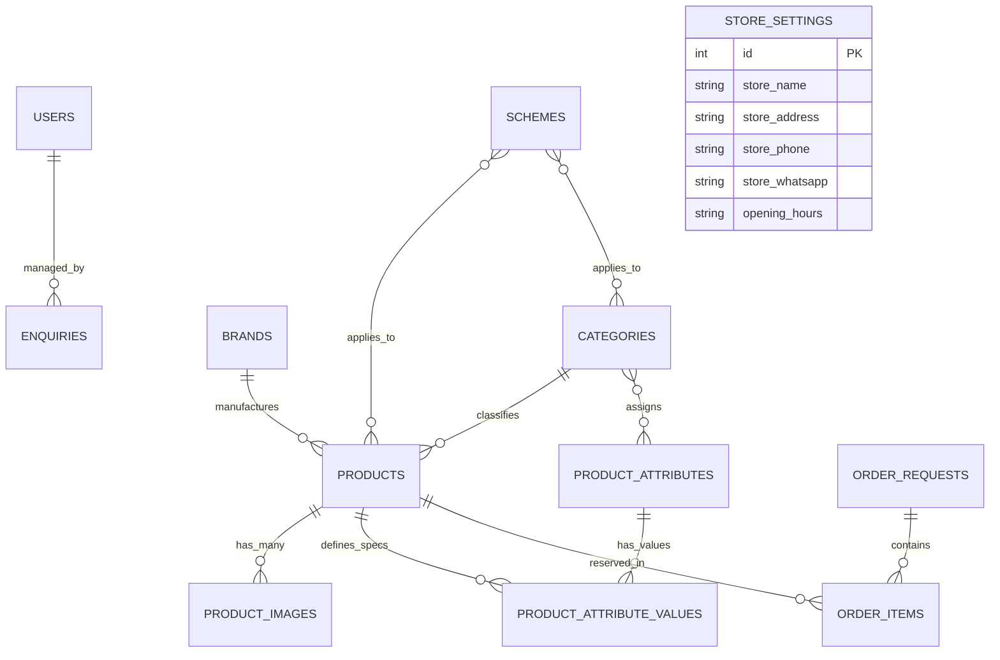

# Database Schema & Data Models (DATABASE.md)
## Bajaj Enterprises — Relational Schema, Entities & Indexing

---

### 1. Entity-Relationship (ER) Diagram



---

### 2. Table Specifications & Schema Definitions

#### 2.1 `users` (Store Staff & Administrators)
| Column Name | Data Type | Constraints | Description |
|---|---|---|---|
| `id` | `INTEGER` | Primary Key, Auto-Increment | Unique identifier |
| `email` | `VARCHAR(255)` | Unique, Not Null, Index | Administrator login email |
| `full_name` | `VARCHAR(255)` | Not Null | Display name (e.g. "Store Owner") |
| `hashed_password` | `VARCHAR(255)` | Not Null | Bcrypt encrypted hash string |
| `role` | `VARCHAR(50)` | Not Null, Default: `'ADMIN'` | Role code (`ADMIN`, `STAFF`) |
| `is_active` | `BOOLEAN` | Not Null, Default: `True` | Account status toggle |
| `created_at` | `DATETIME` | Not Null | Record creation timestamp |
| `updated_at` | `DATETIME` | Not Null | Last update timestamp |

#### 2.2 `brands` (Bicycle Manufacturers)
| Column Name | Data Type | Constraints | Description |
|---|---|---|---|
| `id` | `INTEGER` | Primary Key, Auto-Increment | Unique identifier |
| `name` | `VARCHAR(100)` | Unique, Not Null, Index | Brand name (`AVON`, `HERCULES`) |
| `slug` | `VARCHAR(120)` | Unique, Not Null, Index | URL slug (`avon`, `hercules`) |
| `description` | `TEXT` | Nullable | Brand story / heritage description |
| `logo_url` | `VARCHAR(500)` | Nullable | Logo image file path |
| `is_active` | `BOOLEAN` | Not Null, Default: `True` | Display toggle |
| `sort_order` | `INTEGER` | Not Null, Default: `0` | Order in header dropdown |

#### 2.3 `categories` (Bicycle Segments)
| Column Name | Data Type | Constraints | Description |
|---|---|---|---|
| `id` | `INTEGER` | Primary Key, Auto-Increment | Unique identifier |
| `name` | `VARCHAR(100)` | Unique, Not Null, Index | Category name (e.g. `Mountain Bicycles`) |
| `slug` | `VARCHAR(120)` | Unique, Not Null, Index | URL slug (e.g. `mountain-bicycles`) |
| `description` | `TEXT` | Nullable | Category summary |
| `image_url` | `VARCHAR(500)` | Nullable | Category cover photo |
| `is_active` | `BOOLEAN` | Not Null, Default: `True` | Filter visibility |
| `sort_order` | `INTEGER` | Not Null, Default: `0` | Showcase display sequence |

#### 2.4 `products` (Bicycles Master)
| Column Name | Data Type | Constraints | Description |
|---|---|---|---|
| `id` | `INTEGER` | Primary Key, Auto-Increment | Unique identifier |
| `name` | `VARCHAR(255)` | Not Null, Index | Bicycle Model Name (e.g. `AVON Buena 26T`) |
| `slug` | `VARCHAR(280)` | Unique, Not Null, Index | Clean product URL slug |
| `sku` | `VARCHAR(100)` | Unique, Not Null, Index | Factory SKU / Inventory code |
| `model_number` | `VARCHAR(100)` | Nullable, Index | Manufacturer model code |
| `brand_id` | `INTEGER` | Foreign Key (`brands.id`) | Linked manufacturer |
| `category_id` | `INTEGER` | Foreign Key (`categories.id`) | Primary bicycle segment |
| `selling_price` | `FLOAT` | Not Null | Current selling/showroom price (₹) |
| `mrp` | `FLOAT` | Nullable | Maximum Retail Price for strikethrough (₹) |
| `cost_price` | `FLOAT` | Nullable | Wholesale dealer acquisition cost (₹) |
| `stock_quantity` | `INTEGER` | Not Null, Default: `0` | Current units available in showroom |
| `availability_status`| `VARCHAR(50)`| Not Null, Default: `'IN_STOCK'` | `IN_STOCK`, `LOW_STOCK`, `OUT_OF_STOCK` |
| `description` | `TEXT` | Nullable | Full sales & engineering overview |
| `warranty_info` | `VARCHAR(255)` | Nullable | Frame / component warranty duration |
| `is_published` | `BOOLEAN` | Not Null, Default: `True` | Customer storefront visibility |
| `is_featured` | `BOOLEAN` | Not Null, Default: `False`| Featured on homepage showcase |
| `is_archived` | `BOOLEAN` | Not Null, Default: `False`| Soft deletion flag |

#### 2.5 `product_images` (Photographs)
| Column Name | Data Type | Constraints | Description |
|---|---|---|---|
| `id` | `INTEGER` | Primary Key, Auto-Increment | Unique identifier |
| `product_id` | `INTEGER` | Foreign Key (`products.id`, CASCADE) | Linked bicycle |
| `image_url` | `VARCHAR(500)` | Not Null | Image file path / CDN URL |
| `thumbnail_url` | `VARCHAR(500)` | Nullable | Auto-generated 300x300 thumbnail |
| `is_primary` | `BOOLEAN` | Not Null, Default: `False` | Main thumbnail for cards |
| `sort_order` | `INTEGER` | Not Null, Default: `0` | Gallery slide order |
| `alt_text` | `VARCHAR(255)` | Nullable | SEO image description |

#### 2.6 Dynamic Custom Attributes Engine (EAV Hybrid Pattern)
Allows the store admin to introduce new bicycle specs (e.g., `Wheel Size`, `Gear Count`, `Brake Type`, `Suspension`) without altering database tables or writing backend code.

- **`product_attributes`:** Defines the attribute key, display label, type (`text`, `number`, `select`), unit (`inches`, `speed`), and display flags (`show_in_filters`, `show_in_card`, `show_in_specs`).
- **`product_attribute_values`:** Stores the specific value for a product (`product_id`, `attribute_id`, `value_text`, `value_number`, `value_boolean`).

#### 2.7 `schemes` (Promotions & Volume Discounts)
| Column Name | Data Type | Constraints | Description |
|---|---|---|---|
| `id` | `INTEGER` | Primary Key, Auto-Increment | Unique identifier |
| `title` | `VARCHAR(200)` | Not Null | Promotional name (e.g. "School Season") |
| `discount_type` | `VARCHAR(50)` | Not Null, Default: `'PERCENT'` | `PERCENT` or `FIXED_AMOUNT` |
| `discount_value` | `FLOAT` | Nullable | Discount magnitude (e.g. 10% or ₹500) |
| `eligibility` | `VARCHAR(255)` | Nullable | Criteria (e.g. "On 20T & 24T cycles") |
| `terms` | `TEXT` | Nullable | Offer conditions & disclaimer |
| `end_date` | `DATETIME` | Nullable | Offer expiration date |
| `is_active` | `BOOLEAN` | Not Null, Default: `True` | Live activation switch |

#### 2.8 `enquiries` (Customer Leads)
| Column Name | Data Type | Constraints | Description |
|---|---|---|---|
| `id` | `INTEGER` | Primary Key, Auto-Increment | Unique identifier |
| `reference_no` | `VARCHAR(50)` | Unique, Not Null, Index | Public reference (e.g. `BE-ENQ-10492`) |
| `name` | `VARCHAR(150)` | Not Null | Customer full name |
| `phone` | `VARCHAR(50)` | Not Null | Customer mobile number |
| `message` | `TEXT` | Not Null | Customer question or model enquiry |
| `status` | `VARCHAR(50)` | Not Null, Default: `'NEW'` | `NEW`, `CONTACTED`, `AWAITING_CUSTOMER`, `RESOLVED`, `CLOSED` |
| `internal_notes`| `TEXT` | Nullable | Private showroom staff remarks |

#### 2.9 `order_requests` (Showroom Reservations)
| Column Name | Data Type | Constraints | Description |
|---|---|---|---|
| `id` | `INTEGER` | Primary Key, Auto-Increment | Unique identifier |
| `reference_no` | `VARCHAR(50)` | Unique, Not Null, Index | Booking code (e.g. `BE-REQ-84721`) |
| `customer_name` | `VARCHAR(150)` | Not Null | Customer name |
| `customer_phone`| `VARCHAR(50)` | Not Null | Customer mobile number |
| `delivery_preference`| `VARCHAR(50)`| Not Null | `STORE_PICKUP` or `LOCAL_DELIVERY` |
| `total_amount` | `FLOAT` | Not Null | Total order value (₹) |
| `status` | `VARCHAR(50)` | Not Null, Default: `'RECEIVED'` | `RECEIVED`, `UNDER_REVIEW`, `CONFIRMED`, `READY_FOR_PICKUP`, `DELIVERED`, `CANCELLED` |

---

### 3. Database Indexes for High-Speed Querying

```sql
-- Fast Catalogue Search and Facet Filtering
CREATE INDEX ix_products_sku ON products (sku);
CREATE INDEX ix_products_slug ON products (slug);
CREATE INDEX ix_products_brand_cat ON products (brand_id, category_id, is_published);
CREATE INDEX ix_products_availability ON products (availability_status);

-- Attribute Lookup Optimization
CREATE INDEX ix_attr_val_lookup ON product_attribute_values (product_id, attribute_id);

-- Enquiries and Orders Reference Lookup
CREATE INDEX ix_enquiries_ref ON enquiries (reference_no);
CREATE INDEX ix_orders_ref ON order_requests (reference_no);
```

---

### 4. Alembic Migration Commands

```bash
# Generate a new migration revision based on model changes
alembic revision --autogenerate -m "add_indexes_and_moq"

# Apply pending migrations to current database
alembic upgrade head

# Rollback last migration
alembic downgrade -1
```
