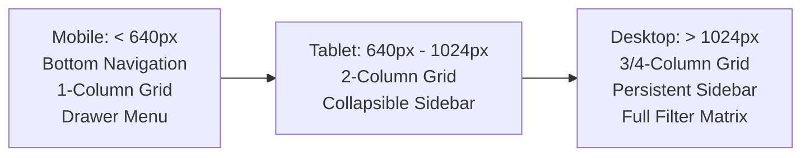

# Design & UI/UX Specification Document (DESIGN.md)
## Bajaj Enterprises — Design System & Visual Aesthetics

---

### 1. Design Philosophy

The Bajaj Enterprises web platform is crafted to provide a **premium, trustworthy, and modern commercial aesthetic** tailored for the Indian bicycle industry. 

Key design principles:
1. **Showroom Authenticity:** Evoking the physical presence of a high-end bicycle showroom in Bikaner with deep slate tones, crisp emerald accents, and high-clarity photography.
2. **Bilingual Accessibility:** Bilingual micro-copy (English + Hindi explanations) designed to empower non-technical showroom staff and regional dealers.
3. **Visual Hierarchy & Scannability:** Bicycle buyers scan for brand, wheel size, gear count, and price in seconds. Key specifications are visually prioritized with distinct badges and icons.
4. **Zero Placeholder Policy:** Every product, banner, and brand asset uses production-ready imagery and SVG vector graphics.

---

### 2. Design Tokens & Color Palette

```
  PRIMARY BRAND           ACCENT SUCCESS          WARNING / DEALS         SURFACE / DARK
┌─────────────────┐     ┌─────────────────┐     ┌─────────────────┐     ┌─────────────────┐
│  Emerald Green  │     │   Teal Glow     │     │   Amber Gold    │     │   Slate 900     │
│    #059669      │     │    #14B8A6      │     │    #F59E0B      │     │    #0F172A      │
│  Tailwind: 600  │     │  Tailwind: 500  │     │  Tailwind: 500  │     │  Tailwind: 900  │
└─────────────────┘     └─────────────────┘     └─────────────────┘     └─────────────────┘
```

#### Detailed Token Mapping

| Token Name | Hex Code | Tailwind Utility | Semantic Purpose |
|---|---|---|---|
| `--color-primary-dark` | `#064E3B` | `emerald-900` | Header top bars, high-contrast dark accents |
| `--color-primary` | `#059669` | `emerald-600` | Primary buttons, brand logos, active states |
| `--color-primary-light` | `#10B981` | `emerald-500` | Hover states, active badges, progress bars |
| `--color-primary-subtle`| `#ECFDF5` | `emerald-50` | Background tints, success alerts, card highlights |
| `--color-deal-gold` | `#D97706` | `amber-600` | Promotional schemes, festive discounts, badges |
| `--color-surface-dark` | `#0F172A` | `slate-900` | Admin sidebar, public footer, modal backdrops |
| `--color-surface-card` | `#FFFFFF` | `white` | Product cards, data tables, modals |
| `--color-border-subtle` | `#E2E8F0` | `slate-200` | Card borders, dividers, form input borders |
| `--color-text-main` | `#0F172A` | `slate-900` | Headings, bicycle names, prices |
| `--color-text-muted` | `#64748B` | `slate-500` | Technical specifications, secondary labels |

---

### 3. Typography Hierarchy

The platform imports modern Google Fonts: **Outfit** (for bold, geometric headlines and commercial branding) and **Inter** (for high-legibility body text, data tables, and numbers).

```
Headline 1 (Display):   Outfit Black (font-black), 32px-40px, tracking-tight
Headline 2 (Section):   Outfit Bold (font-bold), 24px-28px, tracking-tight
Headline 3 (Card):      Inter Bold (font-bold), 16px-18px
Body Text:              Inter Regular/Medium, 14px-15px, line-height 1.6
Specification Micro:    Inter Medium/Bold, 11px-12px, tracking-wide uppercase
Currency & Numbers:     Inter Black / Tabular Numbers (₹4,500)
```

---

### 4. Component Design Patterns

#### 4.1 Product Cards (Catalogue Showcase)
- **Container:** Rounded-3xl borders (`rounded-3xl border border-slate-200/80 shadow-sm`), hover transition with smooth elevation and subtle emerald outline.
- **Image Showcase:** Aspect ratio 4:3 with neutral background (`bg-slate-50`), object-contain scaling to prevent distorted bicycle geometry.
- **Badges:**
  - `AVON` / `HERCULES`: Dedicated brand pill with official manufacturer branding.
  - Stock Badge: `In Stock (उपलब्ध)` in emerald pill; `Low Stock` in amber pill.
  - Price Badge: Dual presentation showing MRP strikethrough alongside bold Selling Price.
- **Specification Chips:** 3 quick-glance chips: Wheel Size (e.g. `26T`), Gear Count (e.g. `21 Speed`), Brake Type (e.g. `Dual Disc`).

#### 4.2 Interactive Catalogue Studio (Admin)
- **Grid / Print Layout:** Dual view mode:
  1. **Management Mode:** Interactive tiles with instant `+1 / -1` stock counter buttons, live status toggles, photo capture trigger, and edit modal.
  2. **Print/PDF Mode:** High-contrast, clean 2-column layout designed specifically for A4 printing or PDF export to share with visiting dealers.

#### 4.3 Bilingual Help Mode (दुकानदार सहायता)
- Prominent toggle in Admin header: `Help Mode: ON (सहायता चालू) / OFF`.
- When enabled, emerald-tinted guidance callouts appear across Overview, Catalogue Studio, and Content Editor explaining technical workflows in straightforward Hindi and English.

---

### 5. Responsive Layout Breakpoints



- **Mobile (< 640px):**
  - Sticky compact header with brand logo, search modal trigger, phone button, and hamburger drawer.
  - Single column product stream with thumb-friendly CTA buttons ("Book via WhatsApp", "Enquire").
  - Admin sidebar collapses into top navigation with scrolling tab bar.
- **Tablet (640px – 1024px):**
  - 2-column bicycle grid.
  - Modal-based facet filters.
- **Desktop (1024px+):**
  - Max-width container at `1280px` (`max-w-7xl`).
  - Left persistent filter panel (300px) with real-time dynamic attribute sliders and checkboxes.
  - 3 or 4-column product grid with instant pagination and sorting.

---

### 6. Micro-Interactions & Feedback
- **Buttons:** Subtle active press scaling (`active:scale-95 transition`).
- **Cart & Wishlist Counters:** Live pill indicator animating upon item addition.
- **Toasts & Feedback:** Auto-dismissing 3-second floating feedback banners for inventory updates, price adjustments, and form submissions.
- **Modal Backdrops:** Blurred glassmorphism (`backdrop-blur-sm bg-black/60`) focusing user attention on order reservations and status updates.
