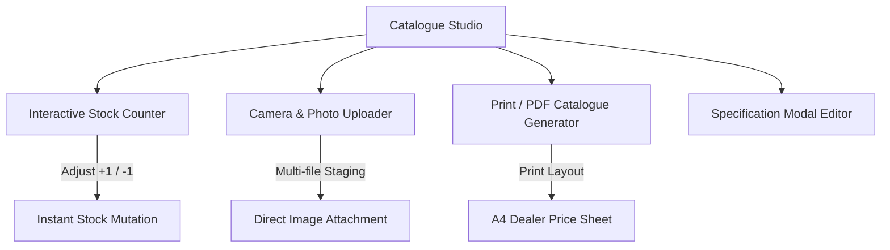
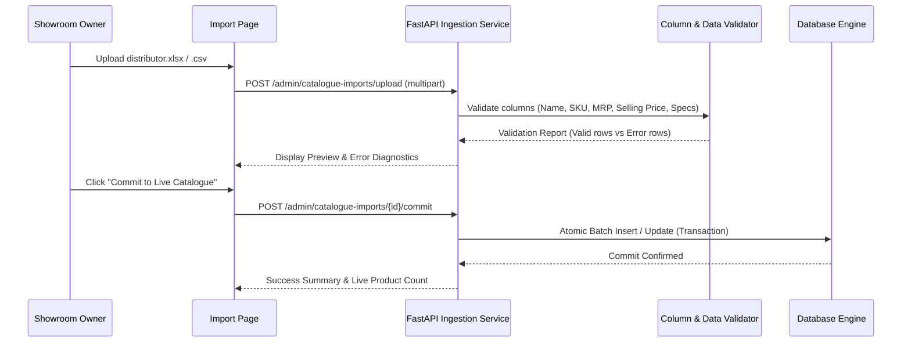

# Feature Development & Systems Guide (FEATURE_DEVELOPMENT.md)
## Bajaj Enterprises — Core Subsystems & Technical Implementation

---

### 1. Product Catalogue Studio (`/admin/catalogue-studio`)

The Catalogue Studio is a purpose-built workspace designed for non-technical bicycle showroom operators to maintain inventory and generate marketing collateral.

#### Key Capabilities:
1. **Instant Stock Counters:** Direct `+1` / `-1` stepper buttons on each bicycle card for quick floor tallying without entering edit forms.
2. **High-Resolution Photo Attachment:** Direct camera capture or file upload with primary image designation.
3. **Print-Ready PDF Catalogue Mode:** Switches the interactive grid into a high-density, two-column printable layout tailored for physical A4 printing or PDF export for visiting sub-dealers.
4. **Status Badging:** Real-time visual feedback for `IN_STOCK`, `LOW_STOCK` (≤ 2 units), and `OUT_OF_STOCK`.

---

### 2. Bulk Catalogue Ingestion Pipeline (`/admin/import`)

Designed to allow wholesalers and dealers to ingest manufacturer spreadsheets (AVON, Hercules, Hero) containing hundreds or thousands of products.

#### Processing Lifecycle:

#### Scaling to 10,000+ Items:
- **Chunked Insertion:** Uses SQLAlchemy batch inserts in chunks of 500 rows (`bulk_save_objects`).
- **CDN Decoupling:** Image URLs are stored as strings referencing high-speed CDNs (Cloudflare R2/AWS S3), avoiding local disk exhaustion.
- **Index Optimization:** Database queries utilize compound indexes on `(sku, is_published, brand_id)` for sub-millisecond retrieval.

---

### 3. Dynamic Custom Attributes Engine (`/admin/attributes`)

Solves the real-world problem where bicycle specifications vary wildly across categories (e.g., Road bikes require *Gear Ratio*, Kids' bikes require *Rider Age / Training Wheels*, MTBs require *Suspension Travel*).

#### Technical Architecture (EAV Hybrid Pattern):
1. **Attribute Definition (`ProductAttribute`):** Stores metadata:
   - `name`: e.g. "Wheel Size"
   - `code`: `wheel_size`
   - `field_type`: `select`, `text`, or `number`
   - `unit`: `inches`, `speed`, `mm`
   - `options`: JSON list of allowed values (e.g. `["16T", "20T", "24T", "26T", "27.5T", "29T"]`)
   - `show_in_filters`: Flag determining if a facet filter is automatically generated on the shop page.
   - `show_in_card`: Flag determining if a specification chip appears on the storefront card.
2. **Attribute Values (`ProductAttributeValue`):** Polymorphic storage associating products with values.
3. **Automatic UI Generation:** Storefront search filters dynamically build checkboxes and sliders from active attribute definitions without modifying React source code.

---

### 4. Promotional Schemes & Discount Engine (`/admin/schemes`)

Allows the store manager to schedule and automate seasonal showroom discounts (e.g., *Festive Diwali Offer*, *School Reopening Discount*).

#### Rule Capabilities:
- **Discount Formats:** 
  - `PERCENT`: Calculated percentage discount (e.g., 10% off).
  - `FIXED_AMOUNT`: Flat cash reduction (e.g., ₹500 off).
- **Eligibility & Terms:** Customizable promotional disclaimers displayed on product detail views.
- **Expiry Dates:** Automated end date validation preventing expired schemes from applying.
- **Active Toggle:** Instantly disable schemes from appearing on the public website without deleting historical records.

---

### 5. Order Reservation Pipeline (`BE-REQ-XXXXX`)

Bicycle purchases in regional trade typically require sizing verification, frame height selection, and showroom assembly before payment.

#### Fulfillment Workflow:
1. **Storefront Booking:** Customer selects bicycles in Cart and clicks **"Submit Showroom Booking"**.
2. **Code Generation:** Generates reference number `BE-REQ-XXXXX`.
3. **Zero Payment Barrier:** Captures intent without forcing a credit card gateway failure.
4. **Admin Dashboard Transition:**
   - `RECEIVED`: New booking arrived.
   - `UNDER_REVIEW`: Staff checking floor stock or assembling bicycle.
   - `CONFIRMED`: Customer notified via WhatsApp/phone.
   - `READY_FOR_PICKUP`: Assembled bicycle waiting at Alakh Sagar Road showroom.
   - `DELIVERED`: Handed over to customer / transport vehicle.

---

### 6. Website Content Management System (`/admin/content`)

Empowers store owners to modify all storefront copy in-browser without touching source code:
- **Homepage Hero:** Headline, subheadline, call-to-action button text.
- **Trust Badges:** 4 value-proposition banners (e.g., *Genuine Warranty*, *Free Assembly*).
- **Showroom Address & Contact:** Phone number, WhatsApp ordering link, verified Google Maps routing URL.
- **Store Policies:** Privacy policy, warranty terms, and return/exchange disclaimers.
