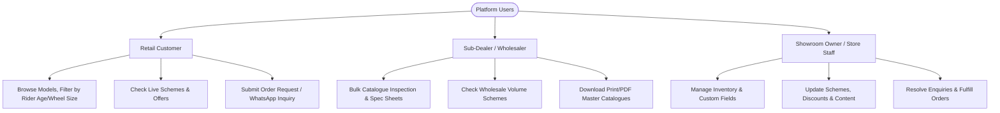

# Product Requirements Document (PRD)
## Bajaj Enterprises — Bicycle E-Commerce & Showroom Management Platform

---

### 1. Document Control & Metadata
- **Project Name:** Bajaj Enterprises Digital Platform
- **Business Entity:** Bajaj Enterprises
- **Location:** Alakh Sagar Road, Kote Gate, Bikaner, Rajasthan 334001, India
- **Core Industry:** Bicycle Retail, Dealership & Wholesale Distribution
- **Authorized Brands:** AVON, HERCULES, and custom multi-category brands
- **Version:** 2.0.0 (Production Release)
- **Status:** Active / Deployed

---

### 2. Executive Summary & Problem Statement

#### 2.1 The Problem
Traditional bicycle dealerships and wholesale distributors in regional commercial hubs (such as Bikaner, Rajasthan) face significant friction with legacy operations:
1. **Printed Catalogue Inefficiency:** Printed manufacturer catalogues quickly become obsolete as prices, specifications, and model availability change frequently.
2. **Disconnected Dealer Communication:** Sub-dealers and retail customers constantly query model availability, wholesale rates, and specifications over phone calls or unorganized WhatsApp chats.
3. **Mismatched E-Commerce Solutions:** Standard B2C platforms (like standard Shopify or WooCommerce) force immediate credit card checkout and door-to-door courier shipping, which does not match Indian B2B/B2C bicycle trade (which relies on showroom reservation, local transport freight/Bilti, GST input credit, and bank settlements).
4. **Technical Barriers for Store Staff:** Most complex enterprise software is intimidating for non-technical retail staff who prefer intuitive, bilingual interfaces with visual cues.

#### 2.2 The Solution
A unified, high-performance web platform that bridges customer-facing discovery with an owner-friendly administrative control room:
- **Public Digital Storefront:** Responsive showcase featuring real-time bicycle search, multi-facet filtering (brand, category, wheel size, gear count, price), dynamic specifications, promotional schemes, wishlisting, and direct WhatsApp / Order Request booking (`BE-REQ-XXXXX`).
- **Owner Administration Suite:** Hidden, role-guarded management portal featuring a visual Catalogue Studio (with print/PDF generation), dynamic attribute creator, bulk CSV/Excel catalogue ingestion, customer enquiry manager, order fulfillment tracking, and zero-code content editing.

---

### 3. User Personas & Target Audiences

#### Persona 1: Direct Consumer (Retail Customer)
- **Profile:** Parents buying kids' cycles, fitness enthusiasts looking for MTBs, daily commuters needing road/city cycles.
- **Needs:** Clear pricing, authentic AVON/HERCULES badges, accurate specifications (wheel size, gear count, frame size), store location, and WhatsApp inquiry options.

#### Persona 2: Regional Sub-Dealer / Wholesaler
- **Profile:** Retail cycle shop owners across Bikaner, Nokha, Nagaur, and rural Rajasthan buying lots of 5 to 50 cycles.
- **Needs:** Instant access to updated model lists, printable rate lists, volume discount schemes, and easy quote requests without requiring credit card checkout.

#### Persona 3: Showroom Owner & Staff (Bajaj Enterprises Admin)
- **Profile:** Store managers and family operators managing daily showroom inventory on Alakh Sagar Road.
- **Needs:** Hindi/English bilingual help mode, visual photo catalogue, quick stock adjustments (+1 / -1), bulk Excel upload from factory sheets, and mobile OTP password recovery.

---

### 4. Key Functional Requirements

| Module | Feature | Functional Specification |
|---|---|---|
| **Public Storefront** | **Hero & Brand Banners** | Carousel banner showcasing active showroom promotions and official AVON/HERCULES dealership banners. |
| **Public Storefront** | **Facet Search & Filters** | Multi-attribute filtering by Brand, Category, Price Range, Wheel Size, Gear Count, and Custom Specifications. |
| **Public Storefront** | **Product Detail View** | High-resolution image gallery, technical specification matrix, stock availability badge (`IN_STOCK`, `LOW_STOCK`, `OUT_OF_STOCK`), EMI/Schemes callouts. |
| **Public Storefront** | **Order Reservation** | Multi-item cart leading to an order reservation modal generating reference numbers (`BE-REQ-XXXXX`). No forced card payment. |
| **Public Storefront** | **Customer Enquiry** | Direct enquiry form with honeypot spam protection, WhatsApp click-to-chat integration, and Google Maps showroom routing. |
| **Admin Portal** | **Authentication & Guards** | Bcrypt hash verification, JWT Bearer tokens, direct URL hiding from public navigation, defense-in-depth route redirection. |
| **Admin Portal** | **Password Management** | Master password hint for initial manual setup, 6-digit Mobile OTP password recovery to registered phone (`+91 94141 38662`). |
| **Admin Portal** | **Catalogue Studio** | Grid view with quick stock adjustment, camera photo upload, print-ready PDF catalogue layout for visiting dealers. |
| **Admin Portal** | **Bulk Import Pipeline** | CSV/Excel spreadsheet upload with column mapping, data validation report, preview, and atomic commit to database. |
| **Admin Portal** | **Dynamic Attributes** | Zero-code creation of custom fields (e.g. suspension type, brake type, frame material) that dynamically appear on filter bars and product pages. |
| **Admin Portal** | **Promotional Schemes** | Create percentage (`%`) or flat amount (`₹`) discounts with validity end dates, terms & conditions, and active toggles. |
| **Admin Portal** | **Enquiry Management** | Lifecycle tracking (`NEW` ➔ `CONTACTED` ➔ `AWAITING_CUSTOMER` ➔ `RESOLVED` ➔ `CLOSED`), internal private notes, CSV export. |
| **Admin Portal** | **Order Requests** | Fulfillment workflow (`RECEIVED` ➔ `UNDER_REVIEW` ➔ `CONFIRMED` ➔ `READY_FOR_PICKUP` ➔ `DELIVERED`), delivery notes. |
| **Admin Portal** | **Website Content Editor**| In-browser WYSIWYG text replacement for store policies, about sections, opening hours, WhatsApp numbers, and announcements. |

---

### 5. Non-Functional Requirements (NFRs)

#### 5.1 Performance & Speed
- **First Contentful Paint (FCP):** < 1.2s on standard 4G mobile networks.
- **Time to Interactive (TTI):** < 2.0s via optimized Vite bundling and dynamic code splitting.
- **API Response Time:** < 50ms for cached and indexed queries (FastAPI + SQLAlchemy 2.0).

#### 5.2 Reliability & Offline Resilience
- **Zero Blank Screen Guarantee:** In situations where the cloud backend is cold-starting or offline, the frontend gracefully falls back to structured standalone data (`fallbackData.ts`), preserving browsing, search, and admin inspection.
- **SPA Routing Integrity:** All deep routes (`/admin`, `/shop`, `/cart`, etc.) are backed by server rewrites (`_redirects`, `vercel.json`, `netlify.toml`) preventing HTTP 404 errors on refresh.

#### 5.3 Security & Compliance
- **Cryptographic Hashing:** Passwords hashed using Bcrypt with salt rounds = 12.
- **Access Control:** Role-Based Access Control (RBAC) separating public visitors from authorized `ADMIN` sessions.
- **Spam Mitigation:** Honeypot hidden fields in public contact and order forms to block automated scrapers and bots.
- **Headers:** Implementation of `X-Frame-Options: DENY`, `X-Content-Type-Options: nosniff`, and `X-XSS-Protection`.

---

### 6. Success Metrics & KPIs
1. **Catalog Digitization:** 100% of showroom bicycles cataloged with photographs, MRP, and wholesale/retail selling prices.
2. **Dealer Response Time:** Reduction in phone enquiry handling time by sharing direct catalogue URLs and PDF sheets via WhatsApp.
3. **Lead Conversion:** Increase in showroom footfall and order bookings via direct reservation tracking (`BE-REQ-XXXXX`).
4. **Administrative Uptime:** 99.9% uptime on serverless edge deployment (Vercel/Netlify).
